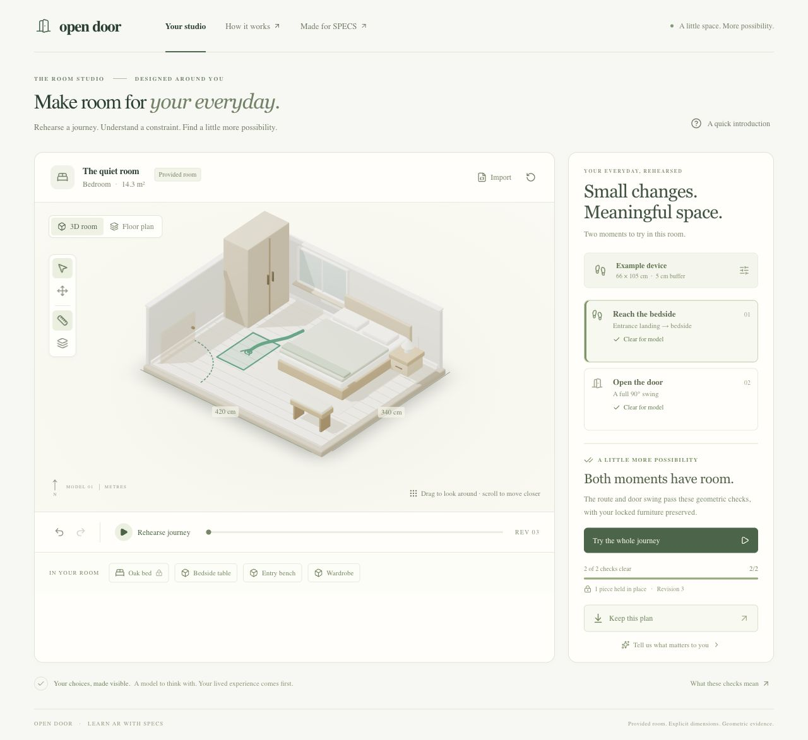

# Open Door

**Make room for your everyday.**

[Open the live companion](https://open-door-weld.vercel.app).

Open Door is a SPECS room-layout rehearsal prototype with a web companion. Explicit dimensions, an occupied device footprint and a chosen task produce inspectable geometric evidence. Moving the table clears the bedside route; the door still meets the bench. Moving the bench clears both checks while preserving the bed.

This is a provided model, not live scene recognition. A clear result applies to the modeled checks, not accessibility certification, comfortable transfers or a person's lived experience.



Actual web companion capture. The separate native Lens and its evidence are described below.

## Run locally

Use Node.js 22, as pinned in `.nvmrc` and the package engine.

```sh
npm ci
npm run dev
```

Open [localhost:3102](http://localhost:3102). Geometry, editing, profile controls, undo/redo, comparison and SVG/JSON exports need no AI key. For reviewed language preferences, copy `.env.example` to `.env` and add a server-side `OPENAI_API_KEY`. Models never determine clearance results.

```sh
npm test
npm run typecheck
npm run verify:fixture
npm run lens:bundle
npm run build
npx next start --port 3104
```

Inspect the production build at [localhost:3104](http://localhost:3104). Deploy this repository root as a Next.js project on Vercel. Its HTTPS APIs use App Router Route Handlers. Keep vendor keys server-side; `.vercelignore` excludes private plans, credentials and native resources from web uploads.

## Open the actual Lens

Open `lens/OpenDoor.esproj` in Lens Studio. The generated project preserves SIK and UI Kit 2.0.0. Authored runtime source is in `lens/Assets/Scripts/OpenDoorExperience.ts`. Its `OpenDoorCore.js` is generated from the same numerical engine as the companion.

Follow [native integration](lens-src/INTEGRATION.md) for inputs and Preview acceptance. `npm run lens:bundle` generates `lens-src/OpenDoorCore.js`; copy it into native `Assets/Scripts/` after engine changes. Never edit scene manifests or caches to bypass native editor workflows.

The Lens has a three-action overview, direct SIK furniture dragging, a Fine adjust submenu, locks, undo, comparison, profile review, miniature/1:1 inspection, witnesses and route playback. Set `companionBaseUrl` to deployed HTTPS for a revision-specific QR handoff. The companion validates and recomputes the encoded model before downloads.

Native compilation and Preview are separate evidence from web/numerical checks. See [verification](devpost/verification.md). No physical glasses have been tested.

## Source map

| Location | Purpose |
| --- | --- |
| `src/engine/` | Geometry, continuous verification, planner, fixtures and sharing |
| `src/components/` | Interactive studio and direct controls |
| `src/app/api/` | Evaluation, export, fixture and language APIs |
| `lens/` | Actual Lens project |
| `lens-src/` | Controller, portable engine and integration contract |
| `tests/` | Independent oracles and state/API regressions |
| `examples/` | Original and revised room models |
| `devpost/` | Curated design, methods, evidence and attribution |

Read the [design brief](devpost/design-brief.md), [geometry note](devpost/geometry.md) and [API contract](devpost/api.md). Private plans, environment files and editor connection credentials remain ignored. Repository/video publication is a separate release action.
