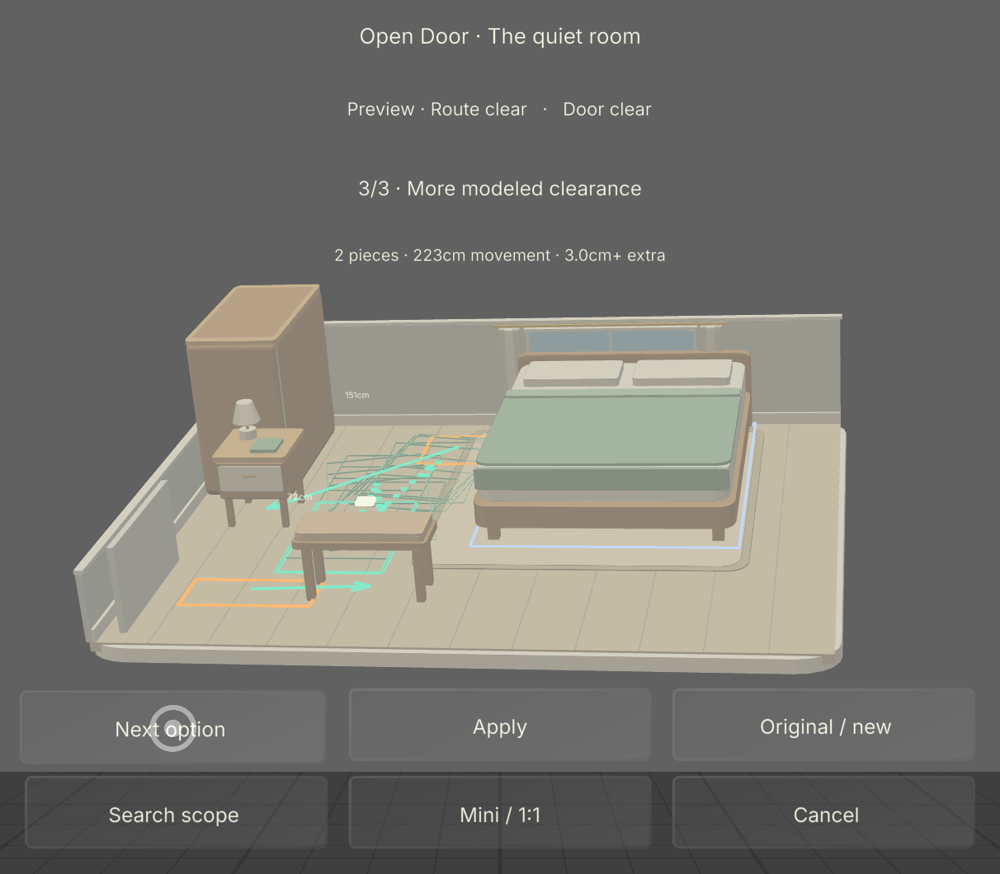
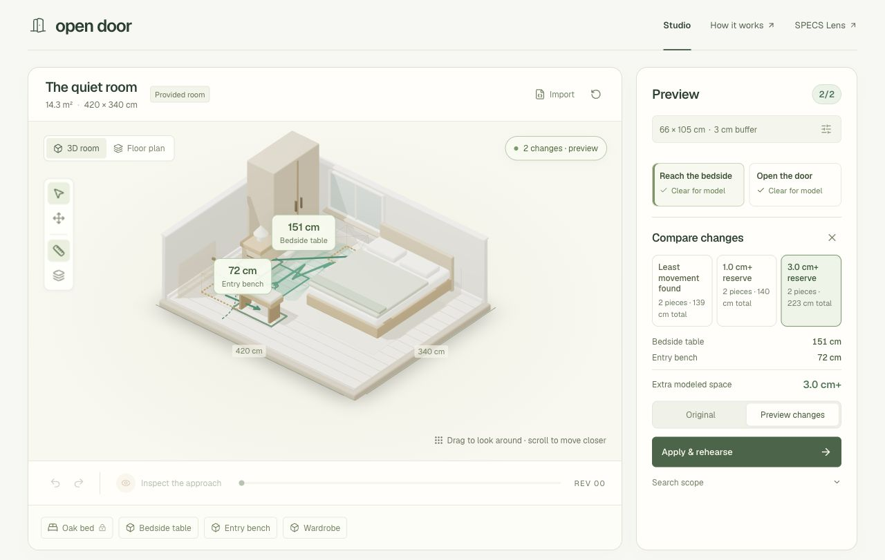

# Open Door

[Open the live companion](https://open-door-weld.vercel.app).

Open Door is a SPECS room-layout rehearsal prototype with a web companion. Explicit dimensions, an occupied device footprint and a chosen task produce inspectable geometric evidence. The companion searches for furniture changes, previews verified alternatives and lets you trade less movement for more modeled clearance while preserving locks.

This is a provided model, not live scene recognition. A clear result applies to the modeled checks, not accessibility certification, comfortable transfers or a person's lived experience.

| SPECS Lens — actual native Preview | Web companion |
| --- | --- |
|  |  |

Actual computed-repair captures. The native image trims only outer margins; [accepted native evidence](devpost/native-repair-preview.md) records actual SIK gestures, source hashes, timing and the exact production handoff.

## Run locally

Use Node.js 22, as pinned in `.nvmrc` and the package engine.

```sh
npm ci
npm run dev
```

Open [localhost:3102](http://localhost:3102). Geometry, computed repairs, editing, profile controls, undo/redo, comparison and SVG/JSON exports need no AI key. For reviewed language preferences, copy `.env.example` to `.env` and add a server-side `OPENAI_API_KEY`. Models never determine clearance results.

```sh
npm test
npm run typecheck
npm run verify:fixture
npm run lens:bundle
npm run build
npx next start --port 3104
```

Inspect the production build at [localhost:3104](http://localhost:3104). Deploy this repository root as a Next.js project on Vercel. Its HTTPS APIs use App Router Route Handlers. Keep vendor keys server-side; `.vercelignore` excludes private plans, credentials and native resources from web uploads.

## Open the actual Lens

Open `lens/OpenDoor.esproj` in Lens Studio. The generated project preserves the installed SIK and UI Kit packages. Authored runtime source is in `lens/Assets/Scripts/OpenDoorExperience.ts`. Its `OpenDoorCore.js` is generated from the same numerical engine as the companion.

Follow [native integration](lens-src/INTEGRATION.md) for inputs and Preview acceptance. `npm run lens:bundle` generates `lens-src/OpenDoorCore.js`; copy it into native `Assets/Scripts/` after engine changes. Never edit scene manifests or caches to bypass native editor workflows.

The Lens source has a three-action overview, computed alternatives with spatial ghosts, direct SIK furniture dragging, Fine adjust, locks, Undo, profile review, miniature/1:1 inspection and occupied-footprint playback. Fast search uses the public HTTPS geometry endpoint; every returned alternative is independently verified locally before display and again before Apply. Network failure offers explicit retry or slower offline search. Set `companionBaseUrl` to deployed HTTPS for a revision-specific QR handoff. The companion validates and recomputes the encoded model before downloads.

The computed-repair Lens completed native compilation and actual Preview acceptance: search/cancel/retry, all alternatives, Original/new, atomic Apply, profile acknowledgment, retained playback, Undo, changed inputs, direct editing and QR handoff. Its final search took 3.249 s with 271 ms of local checks in instrumented Preview. [The certified revision-9 plan](examples/native-repair-plan-r9.json) preserves the accepted model and reserve evidence; a fresh launch starts at the provided baseline. See [verification](devpost/verification.md) for exact scope and historical evidence. No physical glasses have been tested.

## Source map

| Location | Purpose |
| --- | --- |
| `src/engine/` | Geometry, continuous verification, bounded repair search, planner and sharing |
| `src/components/` | Interactive studio and direct controls |
| `src/app/api/` | Evaluation, repair, export, fixture and language APIs |
| `lens/` | Actual Lens project |
| `lens-src/` | Controller, portable engine and integration contract |
| `tests/` | Independent oracles and state/API regressions |
| `examples/` | Original and revised room models |
| `devpost/` | Curated design, methods, evidence and attribution |

Read the [computed repair method](devpost/repair-search.md), [design brief](devpost/design-brief.md), [geometry note](devpost/geometry.md), [API contract](devpost/api.md) and [iteration record](devpost/iterations.md). Private plans, environment files and editor connection credentials remain ignored. Repository/video publication is a separate release action.
