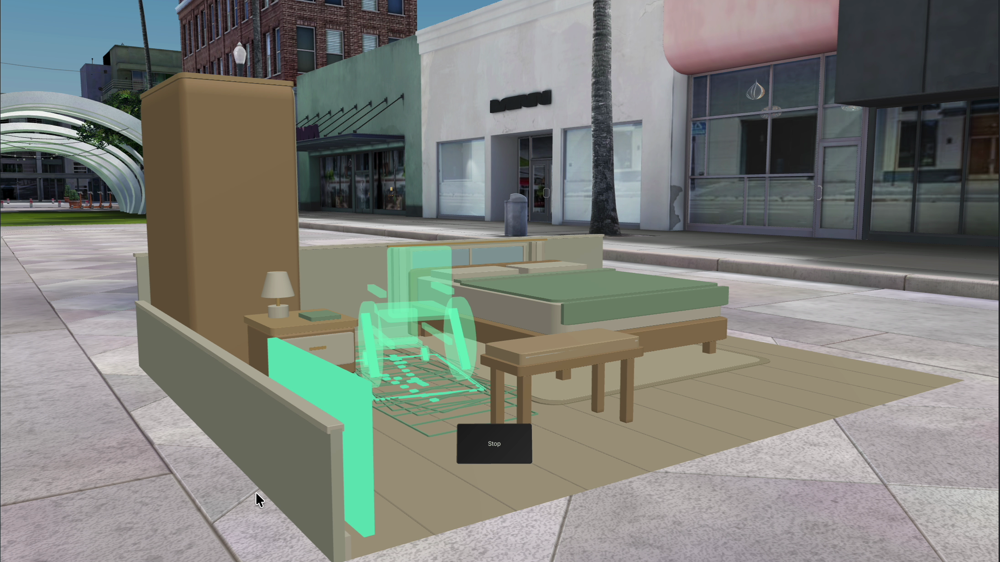
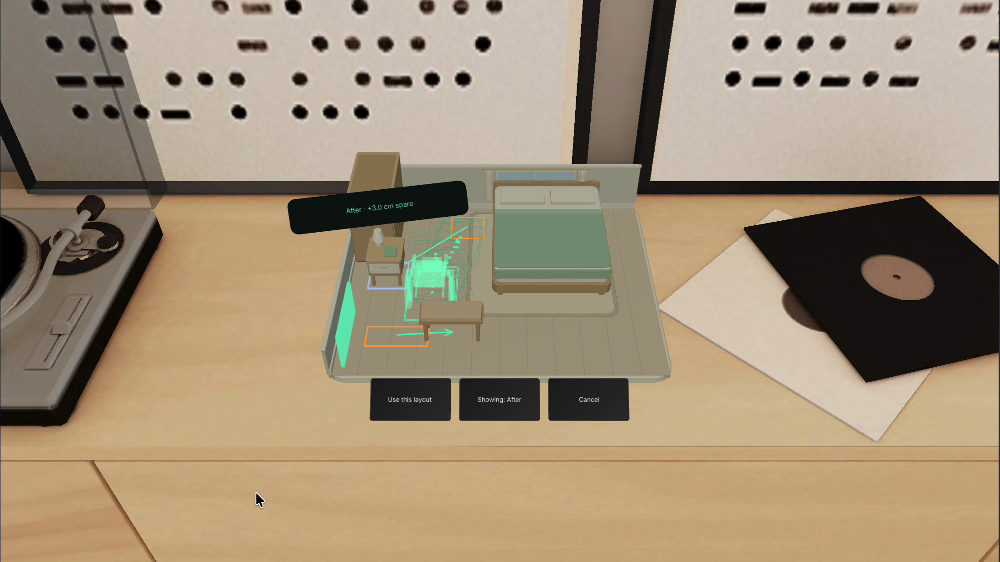

# Open Door

[Open the live companion](https://open-door-weld.vercel.app).

Open Door is a SPECS room-layout rehearsal prototype with a web companion. Explicit dimensions, an occupied device footprint and a chosen task produce inspectable geometric evidence. The companion searches for furniture changes, previews verified alternatives and lets you trade less movement for more modeled clearance while preserving locks.

This is a provided model, not live scene recognition. A clear result applies to the modeled checks, not accessibility certification, comfortable transfers or a person's lived experience.





Actual recorded 8 November Preview frames, cropped to the accepted native viewport. Input is automated SIK; the full-size scene is a separately staged supplied model. [Gallery provenance](devpost/media/spatial-gallery-provenance.json) binds the source and image hashes. [Spatial release evidence](devpost/spatial-release.md) separates accepted source footage from the final film review. The [7 November release](devpost/native-repair-preview.md) remains historical evidence.

## Run locally

Use Node.js 22, as pinned in `.nvmrc` and the package engine.

```sh
npm ci
npm run dev
```

Open [localhost:3102](http://localhost:3102). Geometry, computed repairs, editing, profile controls, undo/redo, comparison and SVG/JSON exports need no AI key. For reviewed language preferences, copy `.env.example` to `.env` and add a server-side `OPENAI_API_KEY`. Models never determine clearance results.

```sh
npm test
npm run typecheck
npm run verify:fixture
npm run lens:bundle
npm run build
npx next start --port 3104
```

Inspect the production build at [localhost:3104](http://localhost:3104). Deploy this repository root as a Next.js project on Vercel. Its HTTPS APIs use App Router Route Handlers. Keep vendor keys server-side; `.vercelignore` excludes private plans, credentials and native resources from web uploads.

## Open the actual Lens

Open `lens/OpenDoor.esproj` in Lens Studio. The generated project preserves the installed SIK and UI Kit packages. Canonical runtime source lives in `lens-src/`; `lens/Assets/Scripts/` is its coordinated editor copy. `OpenDoorCore.js` is generated from the same numerical engine as the companion.

Follow the [spatial integration contract](lens-src/SPATIAL-INTEGRATION.md) for the current canonical source set, measured table/floor placements, audio inputs and LEAF registration. `npm run lens:bundle` generates `lens-src/OpenDoorCore.js`; coordinate native copies after engine changes. Never edit scene manifests or caches to bypass native editor workflows.

The 8 November canonical source places a level miniature on a supplied or explicitly confirmed surface. A schematic wheelchair stays inside the unchanged occupied profile; actual obstruction witnesses light the furniture. Near/far SIK dragging has release-only evaluation, alternatives appear as spatial ghost sets, locks sit on pieces and contextual controls show at most three actions. Full size places the same supplied room on manually configured Preview ground, with lazy-follow controls and detail on approach. This is a supplied model in a simulated environment, not a reconstruction of that environment's furniture.

Fast search uses the public HTTPS geometry endpoint; every returned alternative is independently verified locally before display and again before Apply. Network failure offers explicit retry or slower offline search. Locks, Undo, profile dimensions, preferred trajectories, complete repair evidence and the model-only QR handoff retain their existing contracts. The companion validates and recomputes the encoded model before downloads.

The spatial source passes 64 tests across eight files, application/native TypeScript and the unchanged fixture regression. Exact Direct furniture transactions, far transactions, near UIKit Poke and the complete native rehearsal passed. Independent G2 review accepted the observed miniature, orbit, Center contrast/framing and separate outdoor replay. Main/full-size/share retain the exact revision-3 input and accepted repair; the actual QR decodes to the matching production companion model. The production scene is saved without active test indices or LEAF bridge. See [spatial acceptance and reproduction](devpost/spatial-release.md) and [verification](devpost/verification.md).

The [149.5-second final film](devpost/film-review.md) passed independent encoded QA and complete browser playback. User approval remains pending. Optional WorldQuery placement, unfilmed proximity/lazy-follow transitions and physical glasses remain untested. Center footage shows the initial arrangement with unverified exact input identity; it proves contrast/framing only.

## Source map

| Location | Purpose |
| --- | --- |
| `src/engine/` | Geometry, continuous verification, bounded repair search, planner and sharing |
| `src/components/` | Interactive studio and direct controls |
| `src/app/api/` | Evaluation, repair, export, fixture and language APIs |
| `lens/` | Actual Lens project |
| `lens-src/` | Controller, portable engine and integration contract |
| `tests/` | Independent oracles and state/API regressions |
| `examples/` | Original and revised room models |
| `devpost/` | Curated design, methods, evidence and attribution |

Read the [computed repair method](devpost/repair-search.md), [design brief](devpost/design-brief.md), [geometry note](devpost/geometry.md), [API contract](devpost/api.md) and [iteration record](devpost/iterations.md). Private plans, environment files and editor connection credentials remain ignored. Repository/video publication is a separate release action.
