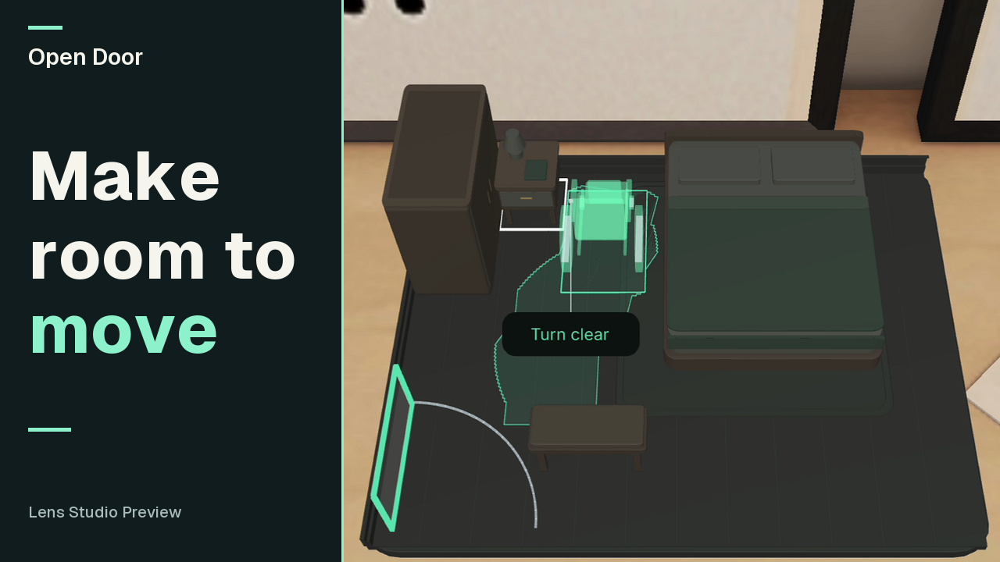

# Open Door

Try furniture moves before anyone has to lift them. Open Door checks whether an example wheelchair can turn beside a bed, and checks the door separately.

[Watch Open Door](https://youtu.be/eqarlEEm_Vk) · [Lens gallery](devpost/gallery.md)

[](https://youtu.be/eqarlEEm_Vk)

## Designed for glasses

- **Move the piece.** Pinch furniture, drag it and release. A start outline and a live centimetre readout make the change visible. A valid release makes one edit and checks the room again.
- **See the consequence.** Amber marks an obstruction. A mint ribbon and the moving chair show a checked route. Clearing the chair’s turn does not imply that the door is clear.
- **Compare a few changes.** Suggest fixes keeps the chair dimensions and locked pieces fixed. One colored layout ghost appears at a time, with Next option and Cancel. Pinch the ghost, compare Before and After, then choose Use.
- **Keep controls out of the room.** Chair settings open in the dock. Object labels seek clear positions with short leaders. An Undo shortcut follows an edit; More keeps Undo after that shortcut expires.

Glasses let the room stay anchored while you inspect the turn from another position. The tabletop gives an overview; the floor view makes the local dimensions tangible.

## Open the Lens

Open [`lens/OpenDoor.esproj`](lens/OpenDoor.esproj) in **Lens Studio 5.23.2**. The tabletop is staged in **Sunlit Room**; the recorded real-size corner uses **Colorful Home**. Select the SPECS 27 preview. The example starts with the table blocking the chair and the bench blocking the door.

Pinch the table to move it, the chair to edit its size, or the door to try its swing. More contains Place and Real size. Placement accepts a horizontal WorldQuery hit after an explicit pinch. A saved spot is an editor convenience; the device startup branch requires a fresh hit.

Real size shows a **2.2 × 2.0 m** bedside corner at scale 1. Floor tape, outlined furniture, the bed corner and a door-direction marker give context. Furniture and the ribbon stop at the displayed corner; the chair stays visible as an outline outside it. The original 4.2 × 3.4 m model and its checks remain unchanged.

When a valid table drag reaches within 2 cm of the wardrobe’s rear line, a guide and click accompany the snap. Release checks that actual position. A later move clears the earlier repair certificate; the previous option’s extra-space number cannot survive it.

[Native setup](devpost/native-setup.md) · [Current verification](devpost/verification.md)

## Companion

[Open the companion](https://open-door-weld.vercel.app) for dimension entry, room editing, computed alternatives and JSON/SVG downloads. **Send to phone** displays a QR carrying the current model. The companion reconstructs that model and checks it again. It does not inherit the selected native trajectory or repair certificate.

For local development, use Node.js 22:

```sh
npm ci
npm run dev
```

Open [localhost:3102](http://localhost:3102). Geometry and editing work without an AI key. Optional language preferences use a server-side `OPENAI_API_KEY`; models never decide geometry results.

```sh
npm test
npm run typecheck
npm run verify:fixture
npm run build
```

Canonical native source is in `lens-src/`. `npm run lens:bundle` rebuilds the portable numerical engine. Coordinate source imports with the editor and never edit generated caches. HTTPS evaluation, repair and export endpoints are Vercel-compatible Route Handlers.

## Built with

- The [Devpost Learn plan-lens framework](https://github.com/challengepost/learn-specs) structured the original [design brief](devpost/design-brief.md), task and Preview limits. Later design reviews drove the surface staging, pinchable chair, indoor corner and clearer presentation.
- **CLAD and Lens Studio MCP** support native implementation, inspection and scene integration.
- **SIK 2.0.0 and UIKit 2.0.0** provide real hand/ray input and persistent controls. **Official 3D Hints 2.0.0** introduce the first gestures.
- **LEAF 2.0.2** exercises the same SIK path with visible scripted hands. Optional scenarios remain in `lens-src/tests/` and `lens/Assets/Scripts/tests/`; the shipping scene has no active test registry, bridge or measurement helper. [Verification](devpost/verification.md) records the current checks.
- **TypeScript, Next.js and Three.js** power the shared geometry and companion. [Attributions](devpost/attributions.md) include packages, fonts and original sounds.

## Scope

The room, furniture and chair dimensions are synthetic. Testing uses Lens Studio Preview and scripted SIK input. Physical Spectacles, human hand tracking and comfort have not been tested.

A surface hit places the model; it does not scan or recognize the room. The bedside display is part of the entered model, not a match to the background furniture. Geometric clearance does not establish transfer ability, complete door operation, comfort or accessibility certification.

The QR is a link fallback. Sending directly to a paired phone is future work, and the companion always performs fresh checks.

[Design, methods, API and verification](devpost/README.md) · [Historical records](devpost/archive/README.md)
