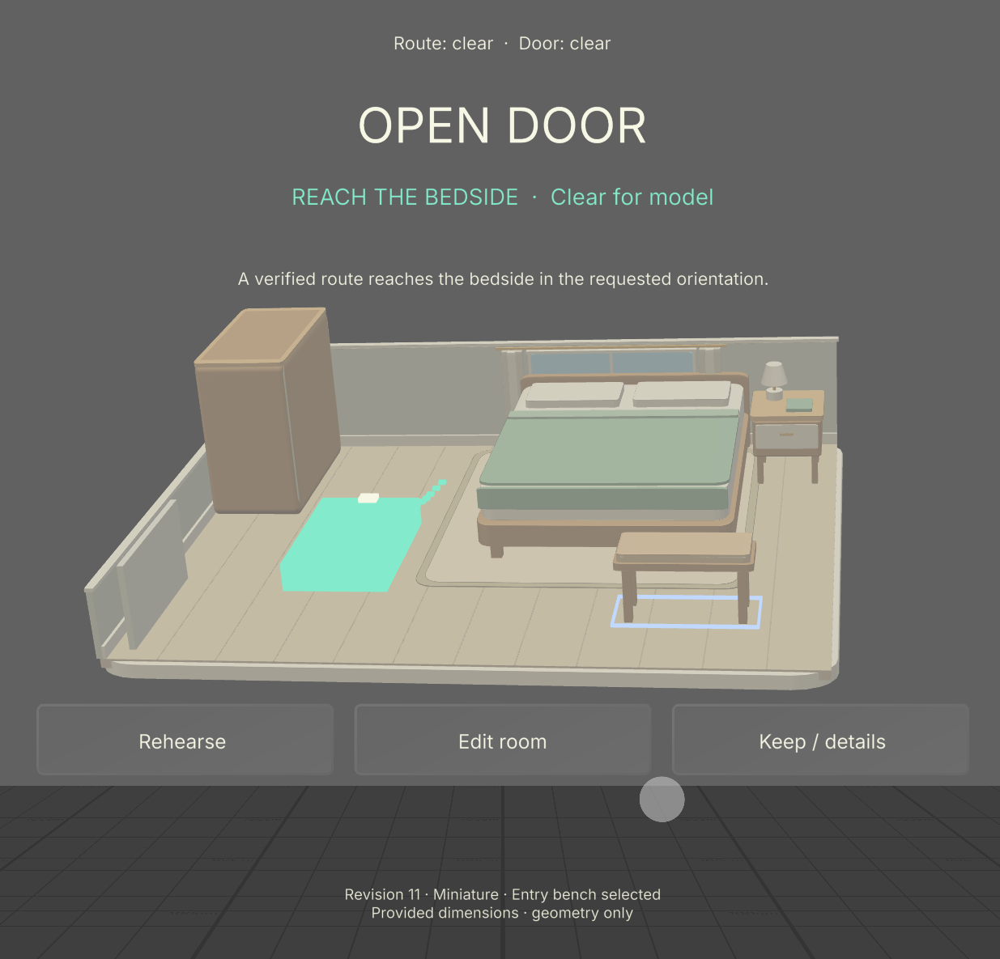
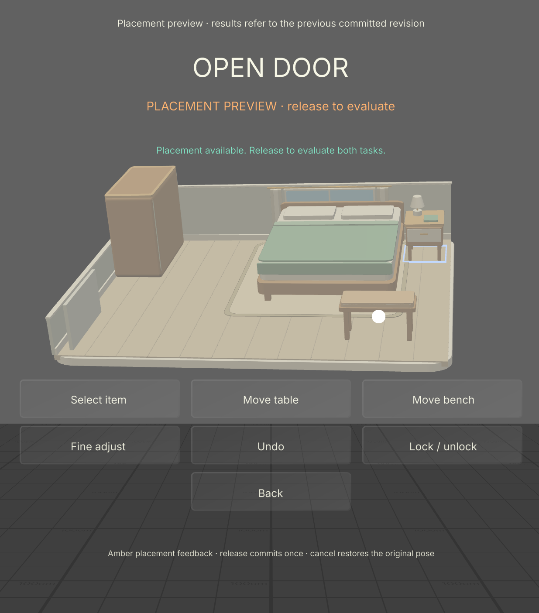

> Historical record of the earlier build. Start with the [current documentation](../../README.md).

# Original direct-edit native Preview evidence

This record belongs to the accepted **original direct-edit release**. Its hashes and captures are historical evidence, not the current remote-search source. The [accepted computed-repair pass](native-repair-preview.md) is the current release evidence.

Completed on 7 November 2026 in **Lens Studio 5.23.2.26081320**, **SPECS 27 Interactive Preview**, using its Plane scene and the installed SIK/UIKit packages. The runtime log reports SIK 0.18.0; this is a runtime identifier, not an assertion about Asset Library package numbering. The actual project is `lens/OpenDoor.esproj`.

The final source compiled, started and rendered successfully. The accepted miniature shows the full room, recognizable furniture, readable status and contextual controls. Camera position and rotation stayed unchanged during miniature/1:1 transitions.

## Observed interaction

The run used **InjectPreviewGesture through the installed SIK mouse/far-ray interactor**. Target coordinates came from runtime camera projection; hover was inspected before separate start/move/release input. Direct public-method calls are not counted as gestures. Twelve recorded assertions passed, including:

| Scenario | Observed result |
| --- | --- |
| Baseline and profile | Revision 0 has table and bench witnesses. Rehearse opens the 66 × 105 cm, 3 cm-buffer test profile; confirmation resumes the requested action. |
| Two distinct fixes | Moving the table produces revision 1 with route clear/door blocked; moving the bench produces revision 2 with both clear. |
| Arbitrary edit | Separate X/Y steps, 15° rotation and Undo change poses under fresh revisions. |
| Miniature drag | Preview preserves inputs/hash/history at revision 2. Release marks a pending commit; the next Update produces exactly revision 3 and one history entry. |
| 1:1 drag | The same transaction boundary holds from revision 8 to 9. The camera remains fixed. |
| Invalid drop and locks | Boundary and bed-overlap drops restore the original geometry in both scales. The locked bed refuses dragging, nudging and unlocking. |
| Playback and comparison | Rehearse moves the occupied footprint along 49 core poses to `(1.52, 2.63)` m. Compare displays baseline/current outcomes and moved-object footprints. |

Full-scale input testing used one disclosed setup call, `commitMove("bench",1.4,2.7)`, to put an unlocked target in the unchanged viewport. Subsequent movement used actual injected SIK gestures, and the setup was undone through UI. That setup call is not presented as a gesture or a view of the complete room at once.

## Final native QR and companion

The final session is **revision 11**, fingerprint **`851f354fb4fef3b3`**. It includes arbitrary bench edits as well as the suggested table move. Both modeled checks are clear. A fresh launch intentionally starts at the provided baseline; the saved project retains source, materials, lighting and endpoint, while the exported plan retains the edited room.

**ZXing-C++ 3.1.1** decoded the complete production URL from the [full, original native QR capture](../../media/native-plan-qr-r11.png). No replacement QR, module reconstruction or crop was used for this check. The decoded URL exactly matched the live share URL, and its fragment restored the exact native input. The public companion returned HTTP 200; its export API returned matching revision/hash/input and the actual [JSON plan](../../../examples/native-preview-plan-r11.json) and [dimensioned SVG](../../../examples/native-preview-plan-r11.svg). Evaluations match to `1e−12`, excluding timing; maximum observed numerical difference was `2.220446049250313e−16`.

A **separate, earlier revision-14 handoff** was independently opened in a fresh browser tab. It imported revision 14, recomputed both checks clear and downloaded JSON through the actual UI with fingerprint **`72b5dad200d31552`**. The browser console was clean. Its [capture](../../media/native-handoff-browser-r14.jpg) and [downloaded JSON](../../../examples/native-preview-plan-r14.json) are retained separately; they are not labeled as the final revision-11 run.

OpenCV 4.13.0 did not detect an earlier dense revision-14 render, while ZXing decoded it exactly. This detector limitation is retained in the record. Physical phone scanning and additive-display QR contrast remain untested.

## Fixes and runtime log scope

Native Preview exposed two issues that source checks had not established. MeshBuilder required a flat interleaved numeric buffer; corrected vertex uploads rendered successfully. Destroying hovered controls/furniture also left SIK cursor wrappers referring to retired targets. The final controller preserves the finite menu roots and four Interactable/collider roots and refreshes only decorative children. The core and geometric checks were unchanged. [Integration notes](../integration-r003/INTEGRATION.md) explain the read-only SIK review behind that lifecycle decision.

The final-source QA interval examined **810,745 log bytes** with no E/F/W diagnostics or Preview error/exception prints, excluding editor transport and analytics payloads. After debugger cleanup, the editor emitted one `QObject::disconnect` warning about a destroyed QTcpSocket signal. Subsequent Preview error prints were empty. That editor teardown warning is disclosed; the clean claim is scoped to the actual QA interval.

The [sanitized evidence record](../../media/native-verification.json) contains source hashes, observed assertions, QR/export comparisons and log scope. The source accepted for this original run had these SHA-256 values (current source has since changed):

| File | SHA-256 |
| --- | --- |
| `OpenDoorExperience.ts` | `677d9524724acc01fce482a722cd4cfbc3a8da911ddb88c9dedb8c9f08e47eea` |
| `ArchitecturalMeshes.ts` | `099e1b16a2b5216beb0179ac1fb47ea12acbbae116289d8fa4135993928b6eef` |
| `OpenDoorCore.js` | `72f1347920c6fd43131c58a6d3a5f99480a599cd5de208695a273f97e6046d08` |

No LEAF run, physical glasses, hardware handtracking, comfort study, thermal/frame-rate result or external user feedback is claimed. The synthetic dimensions and 2D checks do not establish accessibility certification, transfer safety or complete independent door operation.
