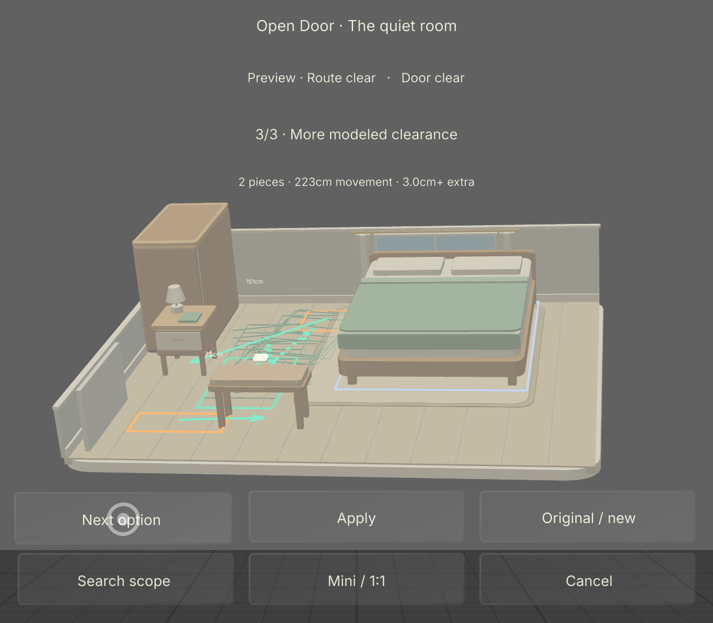
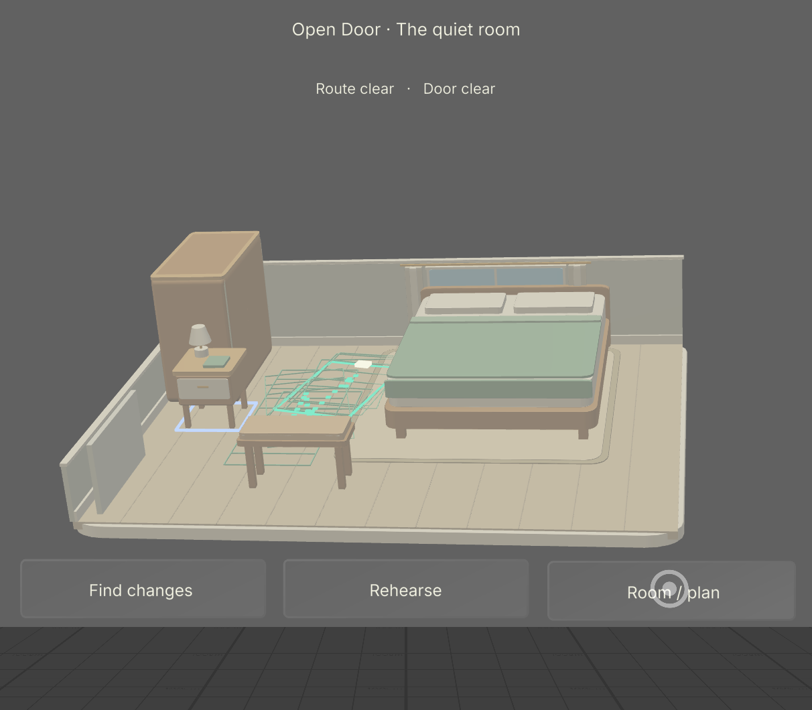

> Historical record of the earlier build. Start with the [current documentation](../../README.md).

# Accepted computed-repair Lens

Completed 7 November 2026 in **SPECS 27 Interactive Preview**, with the bundled Plane scene and installed SIK/UI Kit. Native compilation, fresh startup, the complete repair journey and final save passed. The last ordinary search returned three locally verified alternatives in **3.249 seconds**; local verification took **271 ms total**, with a **108 ms** maximum candidate check. These are instrumented Preview observations, not hardware or percentile claims.

## Actual interaction

The run delivered **InjectPreviewGesture through the installed SIK mouse/far-ray interactor**. A labeled pointer setup placed the cursor at projected coordinates while the mouse was up; observed hover was followed by separate injected start/move/release events. No product handler call is counted as a gesture. Twenty-eight assertions over recorded native observations passed; this count is separate from the automated engine tests.

| Flow | Observed result |
| --- | --- |
| Find / Cancel / retry | Real HTTPS request, unchanged source, cancellation during both requesting and local verification, then three actual alternatives. No partial set appeared while one or two candidates were being checked. |
| Computed choice | Approximately 139/140/223 cm total movement. The first option warns of under-1-mm reserve; the alternatives certify 1.004/3.043 cm extra. |
| Original / new | Source hash/revision/history unchanged; Original shows both blocked, Preview both clear. Ghosts, destinations, centimetre arrows and occupied-footprint samples render. |
| Scale and proposal grabs | Miniature/1:1 changes presentation only. The camera stays fixed. Furniture grabs are refused during search and in both proposal views. Persistent target identities survive rebuilds. |
| Apply / profile / rehearsal | Release queues Apply with the old model intact; the next Update commits one revision/history entry. Profile, locks, dimensions, door and task remain unchanged. Profile acknowledgment resumes the retained trajectory. |
| Playback / Undo | Different actual footprint poses were captured. Playback reaches `(1.52, 2.63, π/2)` m; Undo restores exact prior geometry under a new revision. |
| Changed profile / lock | An in-flight request is canceled by profile navigation; width 71 cm produces different computed destinations. Locking the bedside obstruction produces an honest no-proposal result. |
| Direct editing | Real bench drag remains visual until one release-time commit. Boundary drops roll back; the locked bed refuses dragging. |
| Keep | Actual Room/plan → Keep plan → Show QR displays the exact current model. Back restores the accepted overview. |

The miniature shows the whole room. The [actual 1:1 frame](../../media/native-repair-full-scale.png) is a stationary, limited viewpoint: it does **not** show the whole room at once. The earlier extensive miniature/full-scale drag matrix, including its disclosed setup placement, remains [separate historical evidence](native-preview.md).

## Timing and recovery

| Ordinary production request in native Preview | Reported elapsed | HTTPS/body | Local checks | Maximum check |
| --- | --- | --- | --- | --- |
| First accepted result | 3.697 s | 3.266 s | 470 ms | 165 ms |
| Changed 71 cm profile | 3.926 s | 3.538 s | 388 ms | 162 ms |
| Retry after timeout | 3.421 s | 3.134 s | 292 ms | 124 ms |
| Final fresh repair | 3.249 s | 2.998 s | 271 ms | 108 ms |

Elapsed/HTTPS use the native frame clock; local checks use `Date.now`, so these are not an exact additive budget. The locked-table no-result took 1.948 s. Local checks still occupy roughly 0.1–0.17 seconds in this instrumented Preview.

Supplemental transport tests held real, unmodified HTTP 200 responses. Actual Cancel followed by a new request rejected the old response without resetting the new one. Holding another response triggered the real timeout at 25.001 s; releasing it later did nothing. A clearly labeled simulated transport rejection exposed the error menu; actual Try offline then Cancel ran briefly for 3.056 s. Six supplemental native calls rejected malformed candidates. These injections/calls are not ordinary latency measurements or user gestures. Real transport was restored before final acceptance.

The prior local-only search remained incomplete after 312.07 runtime seconds and was canceled. That failed interaction pace caused the HTTPS pivot; it is not presented as a completed solve. Offline remains explicit and may be slow.

## Exact plan and handoff

The final session is **revision 9**, fingerprint **`e0c04348bacddd78`**. Its accepted repair binds source revision 8/hash `d8c0ee582a62e5cc` and proposal `06d1763ef00dc986`. Two moves total 2.227285052 m, with certified extra reserve **0.030426874516801088 m** and unchanged original buffer **0.03 m**. The bed, wardrobe, locks and task remain unchanged.

ZXing decoded the exact 297-character production URL from the [complete, unmodified 1392 × 1910 native QR screenshot](../../media/native-repair-qr-r9.png). Its fingerprint and every model field round-trip exactly. No reconstructed or cropped QR was used as evidence.

The native diagnostic export retained the accepted motions and certificate. Independent verification reconstructed the atomic repair and recertified the route/door reserve; numerical difference from native results was zero, excluding duration. The production export API reverified the same evidence and returned the actual [certified JSON](../../../examples/native-repair-plan-r9.json) and [dimensioned SVG](../../../examples/native-repair-plan-r9.svg). The SVG was rasterized and visually reviewed. The legacy revision-11 input also passed a fresh production export with its original fingerprint.

Independently, the exact QR URL opened in a fresh browser, visibly showed revision 9 with 2/2 clear, and downloaded [model-only JSON](../../../examples/native-model-share-r9.json) through the real UI. Every input field matched the certified native plan. That share intentionally omits selected repair provenance and permits fresh route planning; it is distinct from the diagnostic/backend certificate. [Actual browser handoff](../../media/native-repair-browser-r9.png).

## Source, logs and limits

The only final source refinement removed a redundant normal proposal footer; the useful small-margin warning remains. The accepted authored/Assets mirrors match:

| File | SHA-256 |
| --- | --- |
| OpenDoorExperience.ts | `29c94a1b7f538f2350cac24b629b034c64d7f02483e174514b7fa8ce1542494b` |
| OpenDoorCore.js | `e25822dda60f356cfcaf70ee1897e2a886e09f85868108ad555eef900a4b3b1e` |
| ArchitecturalMeshes.ts | `099e1b16a2b5216beb0179ac1fb47ea12acbbae116289d8fa4135993928b6eef` |

The final-source interval examined **1,118,880 log bytes**, with zero Lens W/E/F diagnostics and zero unexpected Preview error/exception prints. One expected simulated transport-failure print is retained. One editor-only destroyed-QTcpSocket disconnect warning occurred during debugger cleanup. No SIK lifetime error appeared. These claims apply to the recorded interval, not every possible execution.

The project was saved and the debugger stopped. Saving preserves source/scene/materials/endpoint, not the live revision-9 session; a fresh launch starts at the provided fixture. The exports preserve the edited input. [Sanitized measurements and assertions](../../media/native-repair-verification.json) retain the evidence without machine paths or raw transport logs; [media notes](../2026-11-08/gallery.md) disclose image crops.

No LEAF pass, physical glasses, real handtracking, phone QR scan, hardware frame-rate/thermal/comfort study or external user feedback is claimed. Provided geometry does not establish recognition, accessibility certification, transfer safety, furniture carrying paths or complete door operation.
