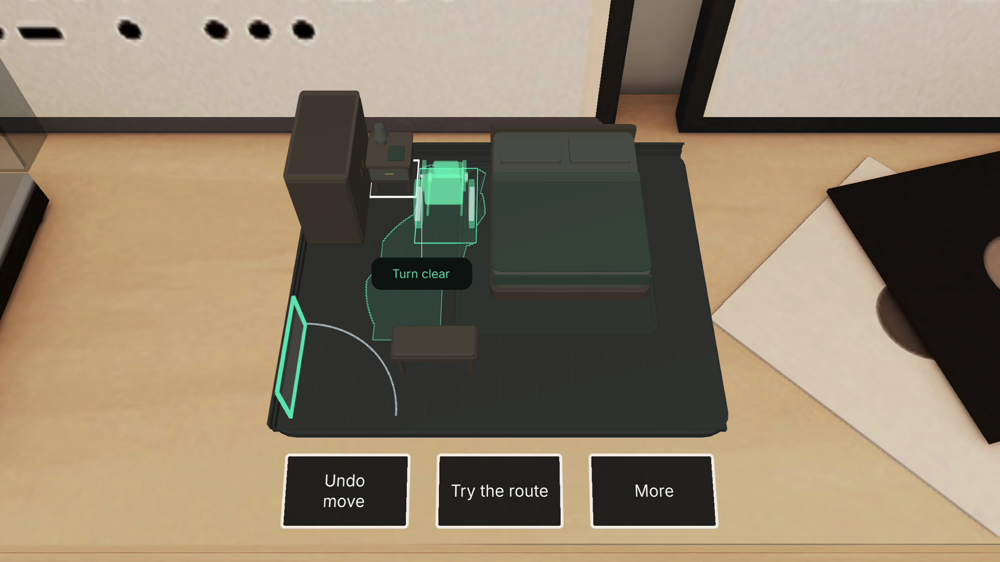
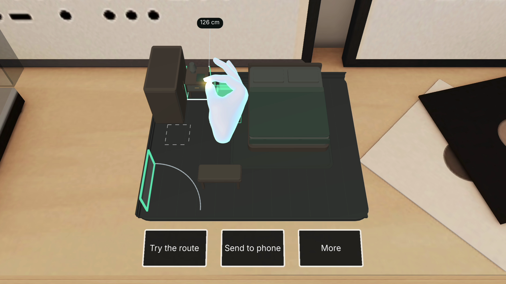
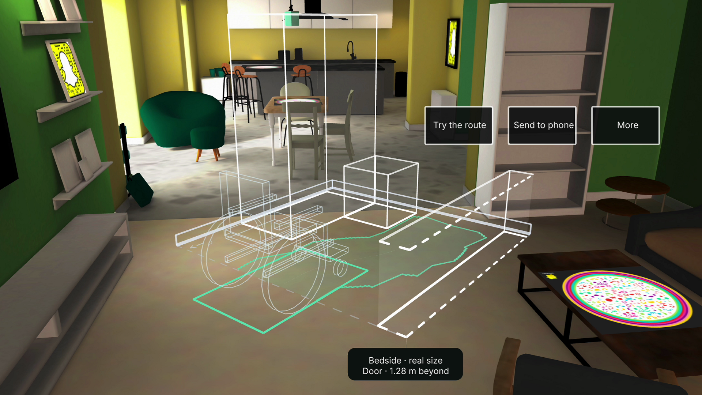
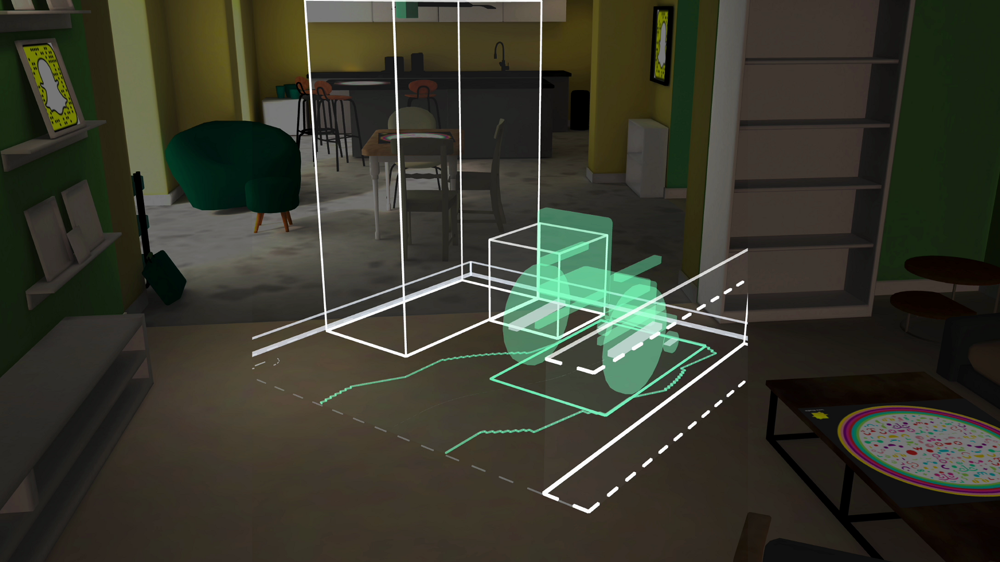

# Open Door gallery

Actual Lens Studio Preview frames from the accepted r004 recordings. The tabletop is in Sunlit Room; the real-size corner is on measured floor in Colorful Home. No hand, furniture or interface is composited into these images.

The table’s rear edge now aligns with the wardrobe. Releasing the drag checks both tasks again, keeping the chosen 3 cm gap.

The actual SIK pinch holds the table at the rear snap. The 126 cm readout, start outline and alignment guide explain the move before release.

The same committed model at scale 1: full wardrobe, table, bed corner, a single route ribbon and clear controls. The 2.2 × 2.0 m floor outline marks the displayed corner. The chair remains an outline beyond that boundary; the door marker points toward the part of the supplied room outside it.

The checked route and furniture remain visible in the Center simulation.

[Close chair-turn detail](media/native-room-turn-r004.png) shows the complete body as the camera reaches the turning area. Controls fade when they cannot fit safely beside the model.

[Image hashes, exact frames, crops and camera scope](evidence/native-gallery-r004.json) · [Current verification](verification.md)

Earlier images remain available in the [historical gallery](archive/2026-11-08/gallery.md) and the retained [r003 source record](evidence/native-gallery.json).
