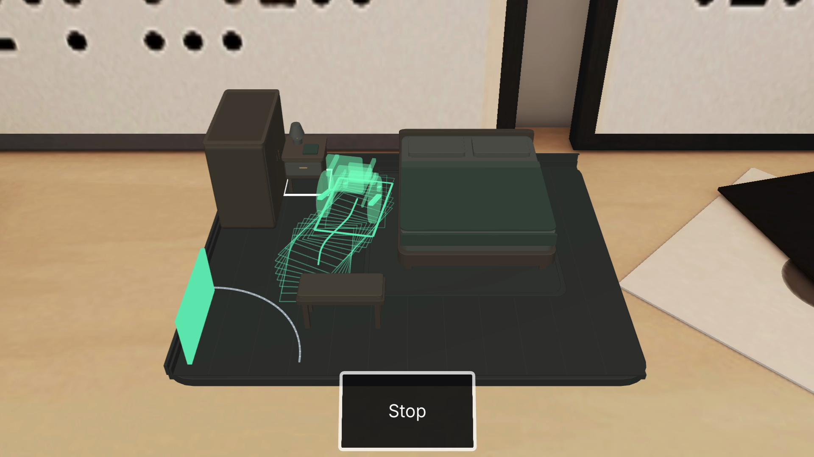
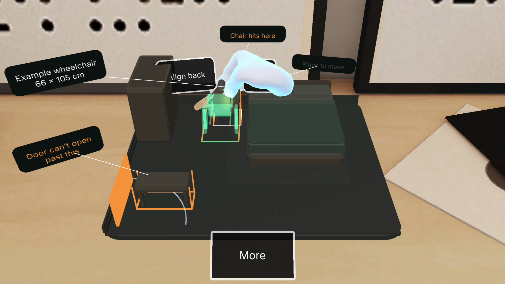
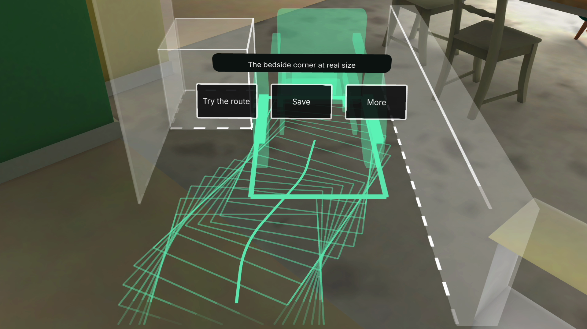
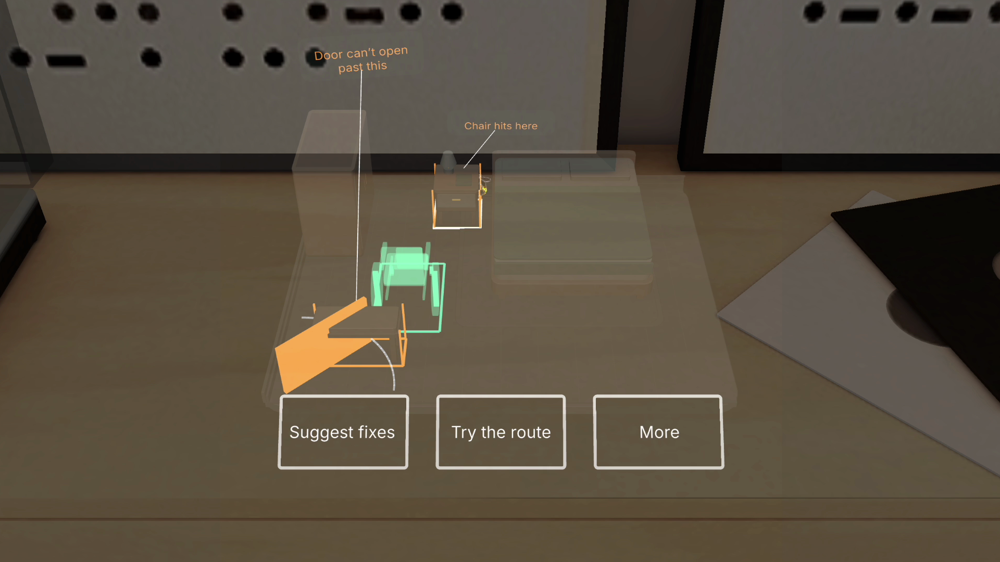

# Open Door gallery

Actual Lens Studio Preview frames show the updated tabletop controls and indoor bedside view. [Scope](../README.md#scope) explains the synthetic inputs and physical-device limits.

The table aligns with the wardrobe; both modeled tasks have been checked again. Final aligned model; 66 × 105 cm example chair.

A visible scripted hand grips the actual table. A legal release commits one edit. Earlier interaction in the continuous demonstration; not its final layout.

The same final layout shows the bedside turn at actual scale on an indoor floor. Only the measured bedside segment is displayed; not the full doorway-to-bed route.

The actual glasses Center simulation shows button rims, warnings and the example chair. Original blocked example; a Preview simulation, not physical glasses footage.

[Image hashes and source frames](evidence/native-gallery.json) · [Film](film-review.md) · [Verification](verification.md)

Earlier outdoor and cursor-era images remain in the [historical gallery](archive/2026-11-08/gallery.md).
