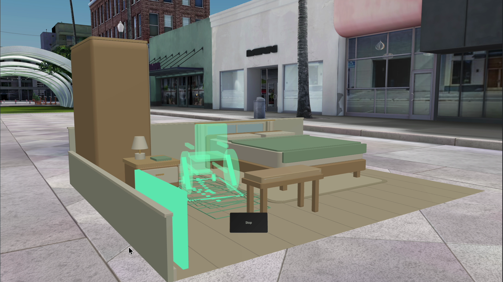
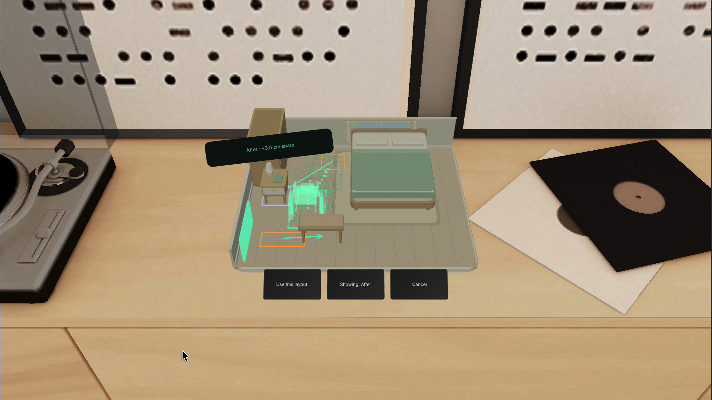
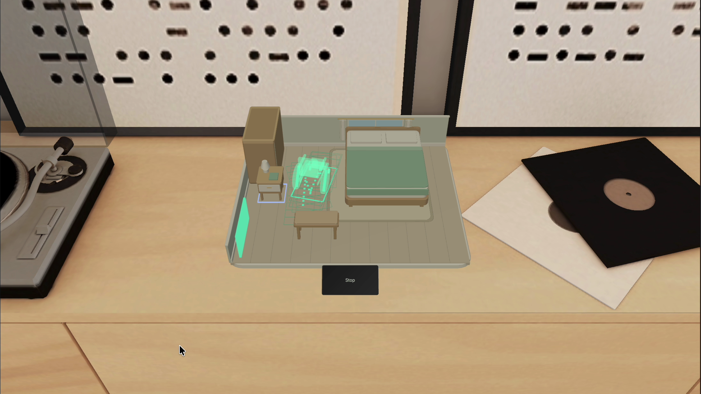
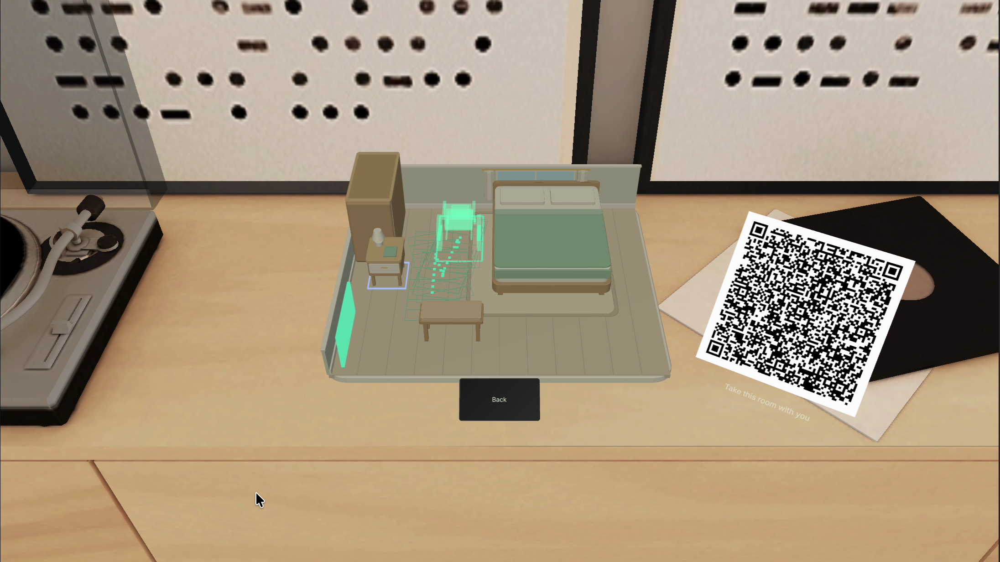

# Spatial release acceptance — 8 November 2026

The observed native spatial presentation and recorded sources are accepted for assembly. This record supersedes pending spatial gates in earlier progress notes without relabeling the 7 November release or failed takes. The 149.5-second final film remains subject to independent encoded QA (G3), uninterrupted playback and the user's approval (G4).

## Observed acceptance

- **Source checks:** 64 tests across eight files, application TypeScript, native/LEAF TypeScript and fixture regression passed. The unchanged portable core SHA-256 is `e25822dda60f356cfcaf70ee1897e2a886e09f85868108ad555eef900a4b3b1e`.
- **Furniture transactions:** the final near run observed exact SIK Direct input, unchanged source during preview and queued `onTriggerEndOutside` release, one evaluated commit, actual Undo, locked-bed refusal and boundary rollback. Both tracking parents were restored after IK cleanup. The final far repeat also passed. Near UIKit Poke has its own accepted observation and is not relabeled Direct. Earlier Direct04 failed IK diagnostics remain historical failures.
- **Presentation:** G2 accepted the observed level miniature on the Sunlit Room sideboard, object-attached feedback, progressive three-target states, actual 24° camera orbit and the final seated full-size replay on Sunlit Outdoor ground.
- **Real-time source:** main take01 contains the complete 65.100-second native scenario. Its protected source interval is 16.8–86.3 seconds: 69.5 seconds uncut at 1×, including genuine handles. It retains 84 distinct moving chair poses and the endpoint. Recorder/source slope is 1.0000271842; pose cadence slope is 0.9997247065. Final full-size03 retains 84 motion updates at cadence slope 0.9997760283 (maximum residual 0.038 seconds).
- **Exact handoff:** main, full-size03 and the separate fresh share take have deeply equal complete inputs and accepted repair at revision 3, input hash `d80f2566c8606cae`. The actual full native source QR decodes the exact 294-character production URL; the production fragment reader reconstructs the exact input and a fresh actual companion page runs its checks. Its four-second film appearance is a disclosed real still, not moving demonstration footage.
- **Clean production:** active functional/film indices, LEAF bridge and temporary helpers were removed; the production scene was restarted and saved with clean compilation/runtime observations. Test source availability does not imply automatic test execution in production.

The accepted source set is bound by `accepted-plan-002.json` and `capture-manifest-002.json`. Raw full-screen recordings, detailed diagnostics and machine paths remain private. Source acceptance is independently recorded in the final r002 source/G2 reviews; passing tests alone did not establish visual acceptance.

## Placement and limits

The accepted miniature surface is `(-30, -142.9, -474)` cm, yaw 0, in Sunlit Room. Full size maps the task start to `(-92, -172.7, -175)` cm, yaw 0, in a separate Sunlit Outdoor scene. These are manually staged supplied geometry, not a scan, recognized room, digital twin or registration to background furniture. The previous Colorful Home wall intersection, thick-floor attempt and late-camera full-size takes are rejected historical staging, excluded from the accepted picture.

The actual Center simulation clip demonstrates contrast and framing only. It shows the initial furniture arrangement; exact input identity is unverified. It must never be represented as the repaired revision-3 layout or route. The ordinary landscape and Center viewports retain their separate simulation geometry.

Optional WorldQuery placement, automatic surface acquisition and unfilmed paired proximity/detail or lazy-follow movement remain unverified. A static context frame does not establish those transitions. Native capture contains no recorded audio; later placed product cues require separate provenance/mix QA. No physical glasses, human hand-tracking, sustained comfort, accessibility certification or user-study result is established.

## Public gallery

All four images are actual recorded frames, uniformly cropped to the accepted `[256, 326, 2192, 1232]` native viewport; no UI was invented or composited. [Sanitized provenance](media/spatial-gallery-provenance.json) binds each output and source SHA-256, timestamp and crop.

## Reproduce without shipping test automation

Open the supplied Lens project normally for the clean production experience. For QA, make a separate development scene copy, install compatible official LEAF 2.0.2, and follow the [integration contract](../lens-src/SPATIAL-INTEGRATION.md). Attach `OpenDoorLeafIndex.ts` once for functional scenarios and optionally `OpenDoorFilmIndex.ts` for film scenarios. The official LEAF panel owns its MessagingBridge: do not create a duplicate bridge. Scenario components register through their indices, not individual scene attachments. Film input is automated SIK and must be disclosed.

After QA remove both test indices, the LEAF bridge and temporary helpers from the production scene, restart Preview, check compilation/runtime, and save cleanly. Keep diagnostic failures and receipts as evidence rather than changing expectations to turn a failed run into a pass. See [paced scenario details](../lens-src/leaf/FILM-REHEARSAL.md).
